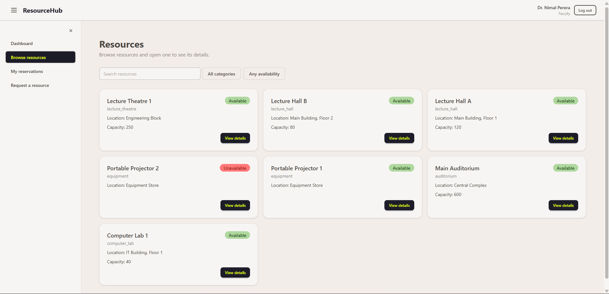
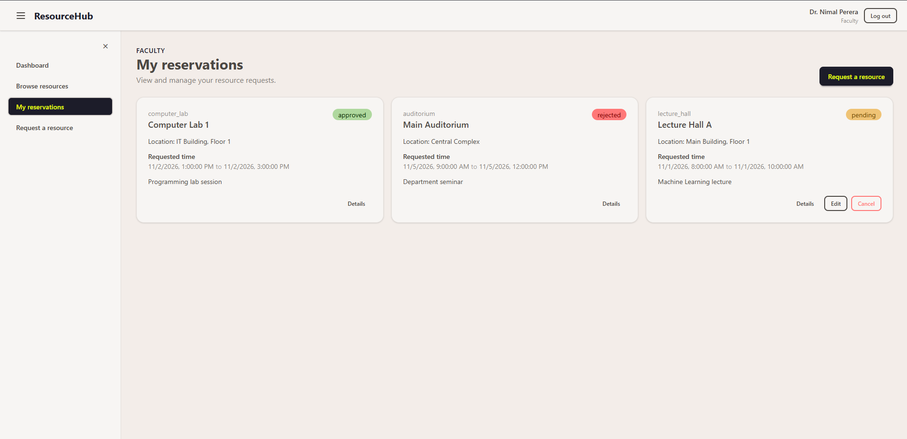
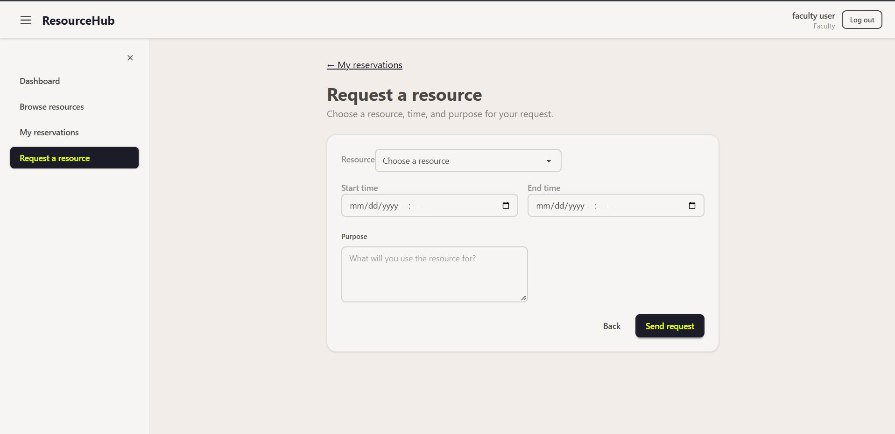
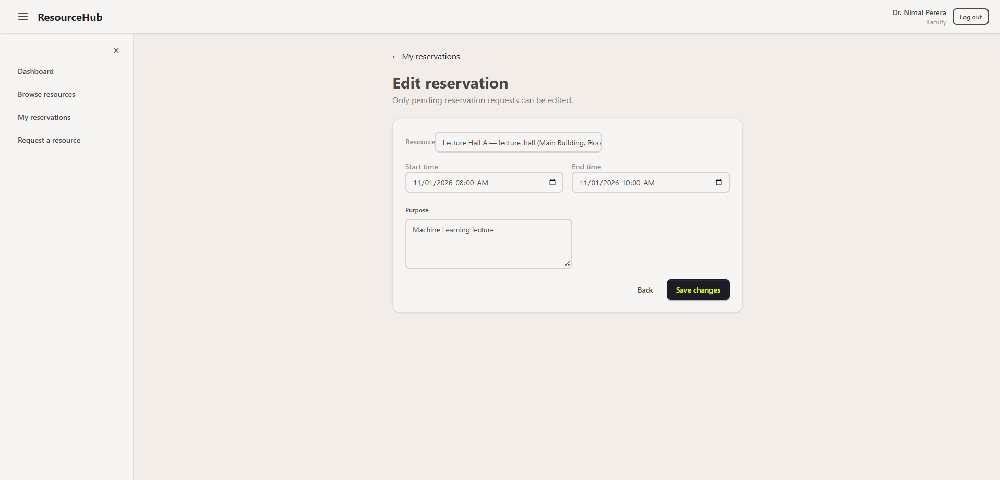
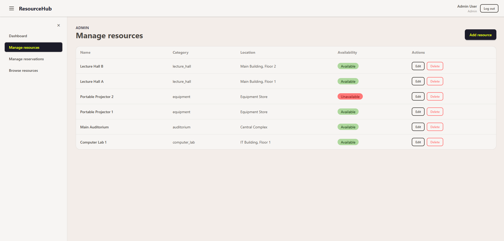
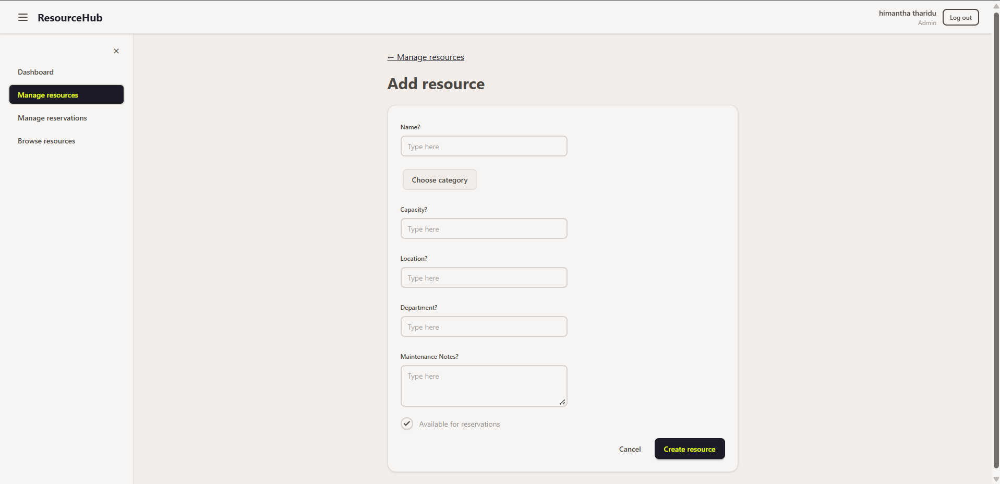
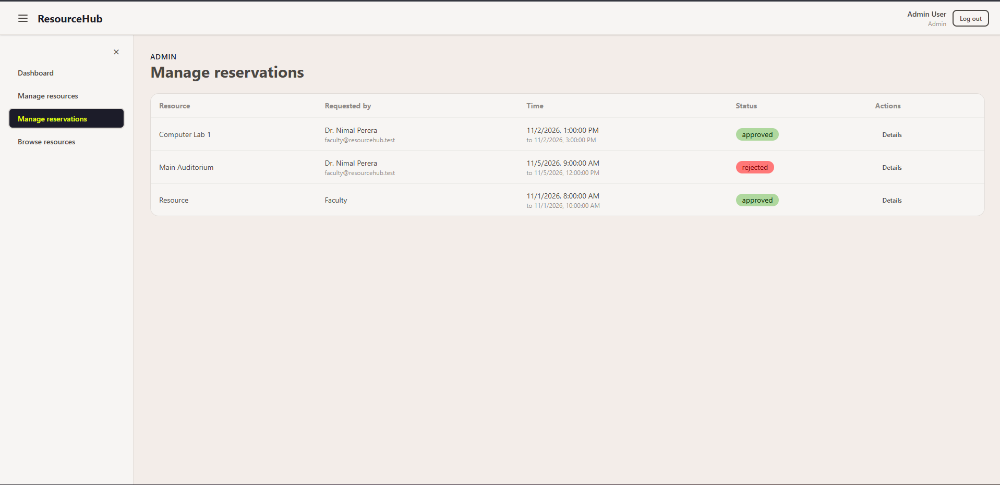
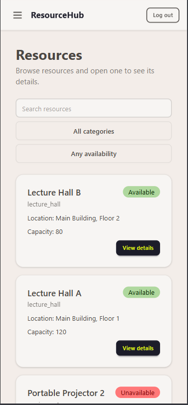
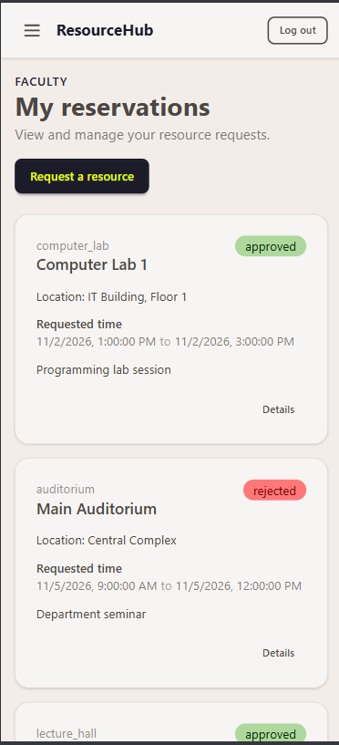
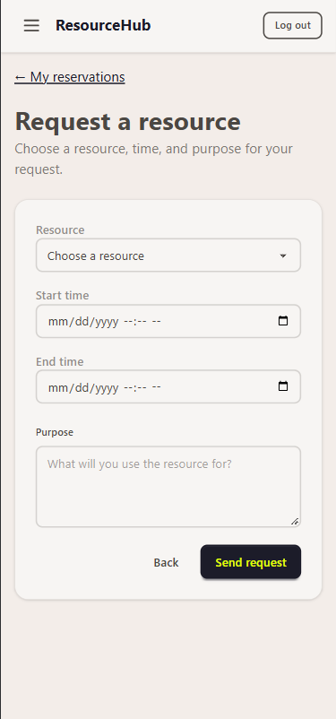

# ResourceHub

University resource reservation system built with the MERN stack (MongoDB, Express, React, Node.js) for the EC4307 Web Application Development mini project.

Faculty members browse lecture halls, lecture theatres, auditoriums, computer labs and equipment, and request reservations for a time period. Administrators manage the resources and approve or reject requests. Overlapping bookings are blocked.

## Features

- Sign up and log in (JWT in an httpOnly cookie, passwords hashed with bcrypt)
- Role-based access: faculty and admin
- Resources: create, view, search and filter, edit and delete (admin); mark a resource unavailable with maintenance notes
- Reservations: create, view, edit and cancel while pending (faculty); approve or reject with notes (admin)
- Conflict check: a resource cannot have two pending or approved reservations that overlap in time
- Responsive layout: collapsible sidebar on desktop, slide-in menu on phones

## Tech stack

| Layer | Technology |
|---|---|
| Database | MongoDB, Mongoose |
| Server | Node.js, Express 5 |
| Client | React 19, React Router 7, Vite |
| Styling | Tailwind CSS 4, DaisyUI 5 |
| Auth | JSON Web Tokens, bcryptjs |

## Screenshots

### Faculty

| Browse resources | My reservations |
|---|---|
|  |  |

| Request a resource | Edit a pending reservation |
|---|---|
|  |  |

### Admin

| Manage resources | Add resource |
|---|---|
|  |  |

| Manage reservations |
|---|
|  |

### Mobile

| Browse resources | My reservations | Request a resource |
|---|---|---|
|  |  |  |

## Getting started

### Requirements

- Node.js 20 or newer
- A running MongoDB (local or MongoDB Atlas)

### 1. Clone and install

```bash
git clone https://github.com/HimanthaTharidu/ResourceHub.git
cd ResourceHub
cd backend && npm install
cd ../frontend && npm install
```

### 2. Configure environment variables

```bash
cp backend/.env.example backend/.env
cp frontend/.env.example frontend/.env
```

Edit `backend/.env`:

```
MONGO_URI=mongodb+srv://<user>:<password>@<cluster>.jlpsmju.mongodb.net/?appName=<cluster>
JWT_SECRET=replace_with_a_long_random_string
PORT=5000
```

Edit `frontend/.env`:

```
VITE_API_URL=http://localhost:5000/api
```

### 3. Load demo data (optional)

```bash
cd backend
npm run seed
```

This **deletes all existing data** and creates demo users, resources and reservations.

| Role | Email | Password |
|---|---|---|
| Admin | admin@resourcehub.test | admin123 |
| Faculty | faculty@resourcehub.test | faculty123 |

These are demo credentials for local use only.

### 4. Run

```bash
# terminal 1
cd backend && npm run dev      # http://localhost:5000

# terminal 2
cd frontend && npm run dev     # http://localhost:5173
```

New accounts created on the Sign up page are faculty members. To make an administrator without the seed script, change a user's `role` to `admin` in the database.

## Tests

Automated API tests use Node's built-in test runner and a separate test database. Add this to `backend/.env`:

```
MONGO_URI_TEST=mongodb+srv://<user>:<password>@<cluster>.jlpsmju.mongodb.net/?appName=<cluster>
```

The test database is wiped on every run, so it must differ from `MONGO_URI`. Then:

```bash
cd backend
npm test
```

## API overview

All endpoints start with `/api`.

| Method and path | Access | Purpose |
|---|---|---|
| POST /auth/signup, /auth/login, /auth/logout | Public | Account and session |
| GET /auth/me | Logged in | Current user |
| GET /resources, /resources/:id | Logged in | List and view resources |
| POST, PUT, DELETE /resources | Admin | Manage resources |
| POST /reservations | Logged in | Request a reservation |
| GET /reservations/me | Logged in | Own reservations |
| GET /reservations/:id | Owner or admin | View one reservation |
| PUT, DELETE /reservations/:id | Owner, pending only | Edit or cancel |
| GET /reservations | Admin | All reservations |
| PATCH /reservations/:id/status | Admin | Approve or reject |

## Project structure

```
backend/
  src/
    config/        database connection
    controllers/   request handling and business rules
    middleware/    authentication and role checks
    models/        User, Resource, Reservation
    routes/        URL to controller mapping
    app.js         Express app
    server.js      starts the server
    seed.js        demo data
  tests/           automated API tests
frontend/
  src/
    api/           API calls
    components/    reusable UI components
    context/       logged-in user state
    layouts/       app layout with sidebar
    pages/         one folder per area (auth, resources, reservations, admin)
docs/screenshots/  images used in this README
```

## Author

EC4307 Web Application Development - Mini Project
[Himantha Tharidu], [EG/2023/5691]
